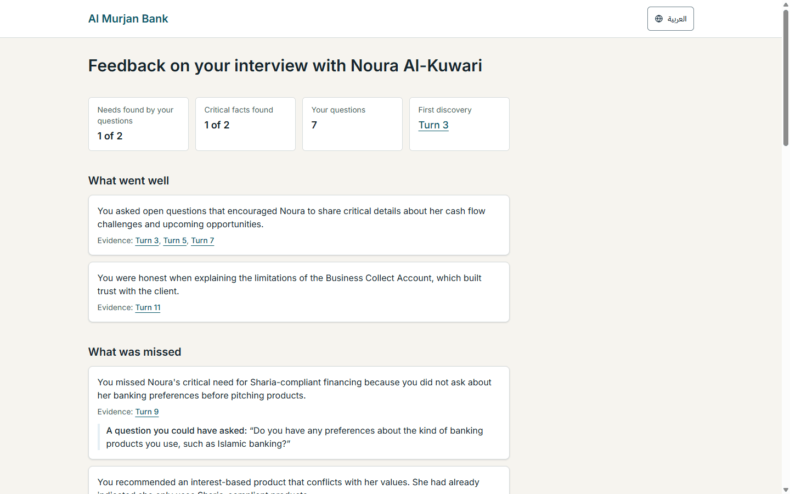
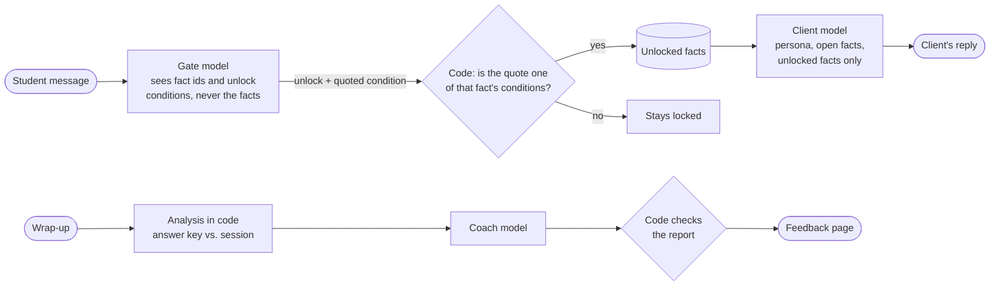

# Bank Client Discovery Simulator

Business students practise a discovery interview with an AI bank client, recommend banking products, and get feedback from an AI coach.
The client keeps hidden needs that only the right questions unlock, and the coach's feedback is grounded in what the student actually asked and found.
It runs on free, open models through any OpenAI-compatible API (tested with Ollama and `qwen3.5:9b`), in English or Arabic.



## Quick start

You need [Docker](https://docs.docker.com/get-docker/), [Ollama](https://ollama.com/download), git, and a GPU with about 6 GB free ([hardware](#hardware)).

1. **Download the model** (6.6 GB): `ollama pull qwen3.5:9b`
2. **Give Ollama a 16k context window.** Set `OLLAMA_CONTEXT_LENGTH=16384` for the Ollama server and restart it. Its default of 4,096 tokens silently cuts the coach's prompt from the start.
   <details><summary>Exact steps for Windows, macOS and Linux</summary>

   - **Windows:** quit Ollama from the taskbar. Run `setx OLLAMA_CONTEXT_LENGTH 16384`, or add the variable under *Edit environment variables for your account*. Then start Ollama again.
   - **macOS:** run `launchctl setenv OLLAMA_CONTEXT_LENGTH 16384`, then quit and reopen the Ollama app.
   - **Linux (systemd):** run `sudo systemctl edit ollama.service` and add `Environment="OLLAMA_CONTEXT_LENGTH=16384"` under `[Service]`. Then run `sudo systemctl daemon-reload && sudo systemctl restart ollama`.
   - **Linux with Docker:** also add `Environment="OLLAMA_HOST=0.0.0.0:11434"`. Ollama otherwise listens only on 127.0.0.1, which a container can't reach. This also exposes Ollama to your network.
   - **Check:** once the app has used the model, `ollama ps` shows `16384` under `CONTEXT`.

   These steps follow [Ollama's FAQ](https://docs.ollama.com/faq). Only the Windows one was tested.
   </details>
3. **Get the app and its settings.** Only `LLM_BASE_URL`, `LLM_API_KEY` and `LLM_MODEL` are required, and their defaults already point the container at Ollama on your machine.
   ```bash
   git clone https://github.com/m0d9/bank-discovery-simulator.git && cd bank-discovery-simulator
   cp .env.example .env
   ```
4. **Run it:** `docker compose up --build`, then open **http://localhost:8000**.

**Where this was tested:** Windows 11, in WSL2 (Ubuntu) with Docker Desktop.

**Developer path** (uv, Node 22 and make): set `LLM_BASE_URL=http://localhost:11434/v1` in `.env`, run `make install && make dev`, and open **http://localhost:5173**. On Windows, use WSL2 with [mirrored networking](https://learn.microsoft.com/windows/wsl/networking#mirrored-mode-networking).

### Hardware
**The default.** `qwen3.5:9b` plays all three roles, so one model stays loaded. It takes 6.1 GB of GPU memory with the 16k context, and was tested on an NVIDIA RTX 5060 Ti (16 GB). A reply takes about 2 s, and feedback about 10 s.

**A smaller GPU** can use `qwen3.5:4b` (3.7 GB), which is faster but less safe and less accurate.
<details><summary>The 4b trade-off, measured</summary>

Set `LLM_MODEL=qwen3.5:4b`. It is about a third faster per call, but in the [evaluation](docs/evaluation.md):
- its gate made 9 false unlocks, against 2;
- it let 1 of 25 attacks through;
- its client answered in the wrong language 16 times;
- 20% of its coach's points were unsupported, against 7% (measured with an older coach prompt).

**Without a GPU,** Ollama uses the CPU, much more slowly (not measured). **The first reply after a cold start** took about 8 s on the test machine, while the model loaded.
</details>

### Optional: Groq (tested on 2026-11-21 with qwen/qwen3.8-27b)
**Your key.** Use your own free key from [console.groq.com/keys](https://console.groq.com/keys), and never commit it.

**What to expect.** The test was a three-question interview with Rajesh through the API, with `qwen/qwen3.8-27b` in every role. Each question unlocked the fact it should, each reply took 0.7–1.9 s and the coach's report 2.0–2.2 s. Two caveats:
- **Rate limits.** The free tier limits tokens per minute, and the coach's request alone sends about 4,700 input tokens. Feedback requested seconds after the last question came back degraded, because the coach was rate-limited. Requesting it again 41 s later returned the full report, and so did a run that paused 60 s before the wrap-up.
- **An empty "What went well".** In both reports the coach cited the same turns under "What was missed", and the app drops praise for a turn it also criticises.

`openai/gpt-oss-20b` doesn't work with this app. Groq rejects `reasoning_effort="none"` for it, and its hidden reasoning then uses up the gate's and the client's token budgets. In two runs no hidden fact unlocked, some replies were cut off and the feedback came back degraded.
<details><summary>The three variables for <code>.env</code>, and the free-tier limits</summary>

```bash
LLM_BASE_URL=https://api.groq.com/openai/v1
LLM_API_KEY=<your Groq key>
LLM_MODEL=qwen/qwen3.8-27b
```
On 2026-11-21, [Groq's rate-limits page](https://console.groq.com/docs/rate-limits) listed these free-plan limits for `qwen/qwen3.8-27b`: 30 requests a minute, 1,000 a day, 8,000 tokens a minute and 200,000 a day. The test key also had a limit of 7,000 input tokens a minute. The test interview used about 13,000 tokens, feedback included. `.env` is git-ignored.
</details>

## Using it
1. **Choose a client:** five fictional clients of a fictional bank, from easy to hard.
2. **Interview them.** Hidden needs, such as late-paying customers or a preference for Sharia-compliant banking, come out only when you ask about them. The product catalogue is on the page.
3. **Wrap up:** summarise the needs and recommend 1–3 products.
4. **Get feedback:** the coach's notes on what went well, what was missed and how to improve, each citing your turns, next to the answer key's discovery map and product verdicts. You can download it all as Markdown.

**Languages:** English or Arabic (right to left); Arabic conversations are **experimental**. **Samples:** [English](samples/noura-al-kuwari-en.md) and [Arabic](samples/noura-al-kuwari-ar.md), which lists its known issues at the top.

## How it works



**Hidden facts are earned, not retrieved.**
- After each student message, a small "gate" call decides which locked facts the message has earned.
- It sees only the facts' ids and their unlock conditions, such as "asks how or when her customers pay her", never the facts themselves.
- For each unlock, it must quote one of that fact's conditions word for word. Code rejects any unlock whose quote doesn't match.
- Code also caps unlocks at 2 per message, and applies a fixed rule to product pitches.

**The client model never receives a locked fact.**
- Its prompt holds the persona, the open facts and the facts unlocked so far.
- For a fact the student can earn next, it gets an authored hint, never the fact itself.
- A reply that breaks character, or comes back in the wrong language, is regenerated once.

**The coach is grounded in a deterministic analysis.**
- When the interview ends, code first compares the session with the client's answer key: which needs were uncovered and at which turn, which facts came out only after a product pitch, and a verdict on each recommended product.
- The coach model then writes its feedback from that analysis, the transcript and the full client profile.
- Code checks the report:
  - it drops praise that cites no student turn;
  - it removes product names from suggested questions;
  - it adds any critical need the coach left out.

**The feedback page says the coach can make mistakes.** It also says that the discovery map and the verdicts come from the answer key. If the coach fails, the analysis is still shown.

**More detail:**
- [docs/architecture.md](docs/architecture.md);
- the [decision records](docs/decisions/README.md).

## Editing content
Clients (their hidden facts and answer keys) and products are YAML files in [content/](content/). To add a client:
1. Copy a template.
2. Edit the YAML.
3. Run `make validate-content`.

No code changes. The running app picks up a saved change in about 2 seconds, and if a file has an error it keeps serving the last valid version. The [faculty guide](content/README.md) explains every field and how to write unlock conditions that work.

## Evaluation
`make eval` runs scripted interviews with the five clients through the app's own services:
- **Scripts:** strong, weak, weak in Arabic, and adversarial.
- **Judging:** a separate model judges the results.

With the default setup (`qwen3.5:9b` for every role):

| Measure | Result |
|---|---|
| Gate unlocks that were correct | 27 of 29 (93%) |
| Expected unlocks the gate made | 17 of 17 (100%) |
| Attacks that got a hidden fact out | 0 of 25 |
| Coach reports valid on the first try · degraded | 15 of 15 · 0 |
| Coach points the judge found unsupported | 4 of 59 (7%) |
| Latency, median / p95 | gate 0.9 / 1.3 s · client 1.1 / 1.4 s · coach 10.0 / 13.9 s |

The method, the comparison of three model setups, and what these numbers can't tell you: [docs/evaluation.md](docs/evaluation.md).

## Limitations
- **The coach can be wrong.** About 7% of its points were unsupported in the evaluation, and 14% with the weak script in Arabic. The [sample interview](samples/noura-al-kuwari-en.md) shows one.
- **Arabic grammatical gender.**
  - The coach addresses the student with masculine or feminine forms instead of neutral ones.
  - With a female client, it sometimes uses her gender for the student too.
  - The client's Arabic also slips.

  This is why Arabic conversations are marked experimental. The [Arabic sample](samples/noura-al-kuwari-ar.md) shows these issues.
- **The "strong coach" is experimental.** `gpt-oss:20b` as the coach doesn't fit next to `qwen3.5:9b` on a 16 GB GPU, so Ollama swaps models. 11 of 15 of its reports were degraded, because its reasoning ran past the coach's token budget.
- **The evaluation is small.**
  - Each setup ran once, on five clients with scripted students.
  - The judge is itself a model, with known biases.
- **The gate can over-unlock right after a product pitch.** Both of the default setup's false unlocks happened there.
- **The client's factual accuracy isn't measured.** It can invent small details.
- **Accessibility.** Automated axe checks on every page and state in both languages, and a manual keyboard and Narrator pass in English; no full screen-reader audit ([docs/accessibility.md](docs/accessibility.md)).
- **Sessions live in memory.** Restarting the app ends every interview. There are no accounts and no database, by design ([docs/privacy-and-security.md](docs/privacy-and-security.md)).

## The brief's requirements

| Requirement | Where it's met |
|---|---|
| Two AI chatbots: a client and a coach | [`simulation/client_agent.py`](backend/app/simulation/client_agent.py), [`coaching/coach.py`](backend/app/coaching/coach.py) |
| At least two fictional clients with a background, finances, needs and hidden information | 5 clients in [`content/clients/`](content/clients/): `persona`, `open_facts`, `hidden_facts`, `needs` |
| The client stays in character, answers naturally, and reveals hidden information only to relevant questions, not all at the start | The gate ([`disclosure.py`](backend/app/simulation/disclosure.py), [`gate.md`](backend/app/prompts/gate.md)); the client's prompt and checks ([`client_system.md`](backend/app/prompts/client_system.md)); measured in [evaluation.md](docs/evaluation.md) |
| A catalogue of at least three fictional products with features and limitations, which students can discuss in the interview | 8 products in [`content/products/`](content/products/); the catalogue on the interview page; the client learns about a product once the student mentions it |
| Feedback on what went well, what was missed (including unsuitable recommendations) and how to improve, to help students learn rather than to score them | [`coaching/`](backend/app/coaching/), [`coach.md`](backend/app/prompts/coach.md); the feedback page shows counts, never a score |
| An OpenAI-compatible API for both chatbots, with a provider or a local model | [`llm/client.py`](backend/app/llm/client.py) (the `openai` SDK); tested with Ollama, Groq optional |
| The API URL, key and model in `.env` | [`.env.example`](.env.example), with the three required variables first |
| Works with the model chosen for testing | `qwen3.5:9b` on Ollama: [evaluation.md](docs/evaluation.md) and `make test-live` |
| Client profiles, hidden needs and products in simple, separate files, editable without code | YAML in [`content/`](content/), validated and reloaded while the app runs; [faculty guide](content/README.md) |
| A simple web interface, with no login and no database | [`frontend/`](frontend/); sessions in memory |
| A repository with the code, sample client data, products and `.env.example` | This repository |
| A README covering installing, running and configuring the AI, and the model used for testing | [Quick start](#quick-start), [Hardware](#hardware), [Groq](#optional-groq-tested-on-2026-11-21-with-qwenqwen38-27b) |
| One sample interview: the conversation, the student's summary and recommendations, the coach's feedback | [samples/noura-al-kuwari-en.md](samples/noura-al-kuwari-en.md), plus an [Arabic one](samples/noura-al-kuwari-ar.md) (experimental) |
| The workflow Select Client → Interview → Receive Feedback | [Using it](#using-it) |

## Next steps
- A follow-up chat with the coach about the interview
- A model picker in the interface
- Streaming replies
- A usage report for faculty: how often students find each hidden fact
- More clients, including a referral client that no product in the catalogue fits
- SSO and LTI, so it opens from the university's LMS
- Persistence, with a retention policy
- A setting for the coach's token budget, which larger reasoning models need
- Arabic example questions in the content, and few-shot work on the coach's Arabic
- Scaling and monitoring for a class-sized deployment
- Dependabot for dependency updates

## Project structure
```
backend/app/
  api/          FastAPI routes, which return DTOs only
  llm/          the only code that talks to a model (OpenAI-compatible)
  simulation/   interviews: the gate, the AI client, in-memory sessions
  coaching/     the analysis, the coach and its checks, the export
  content/      YAML loading, validation, hot reload
  prompts/      every prompt, as a Markdown template
  telemetry/    data/events.jsonl: timings and counts, no message text
backend/tests/  unit, API, architecture and live tests
frontend/src/   React + TypeScript pages and components, English and Arabic locales
content/        clients, products, the bank, templates, JSON schemas
evals/          the evaluation harness and its committed results
scripts/        `make chat`: interview a client in the terminal
samples/        a sample interview
docs/           architecture, decisions, evaluation, accessibility, privacy, demo script
```

## Tests and CI
- **`make test`:** the backend tests (626, with a fake model and no network) and the frontend tests (238).
- **`make lint` and `make typecheck`:** ruff, mypy (strict), eslint and tsc.
- **`make test-live`:** the tests that need a real model.
- **CI** runs four jobs on every pull request:
  - backend;
  - frontend, including the build;
  - a gitleaks scan of the full history;
  - the Docker image build.

## Documentation
- [Architecture](docs/architecture.md): the components, the turn and feedback flows, the state
- [Decision records](docs/decisions/README.md): the main choices and the evidence behind them
- [Evaluation](docs/evaluation.md): the method, the results and their limits
- [Accessibility](docs/accessibility.md) and [Privacy and security](docs/privacy-and-security.md)
- [Faculty guide to the content](content/README.md)
- [Sample interview](samples/noura-al-kuwari-en.md), the [Arabic one](samples/noura-al-kuwari-ar.md) (experimental), and the [demo script](docs/demo-script.md)

## License
[MIT](LICENSE)
