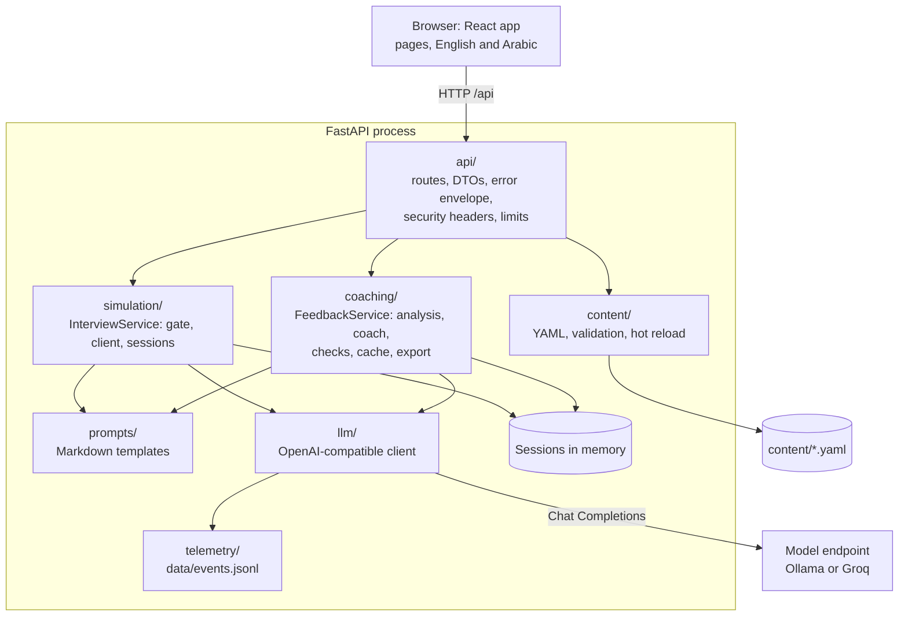
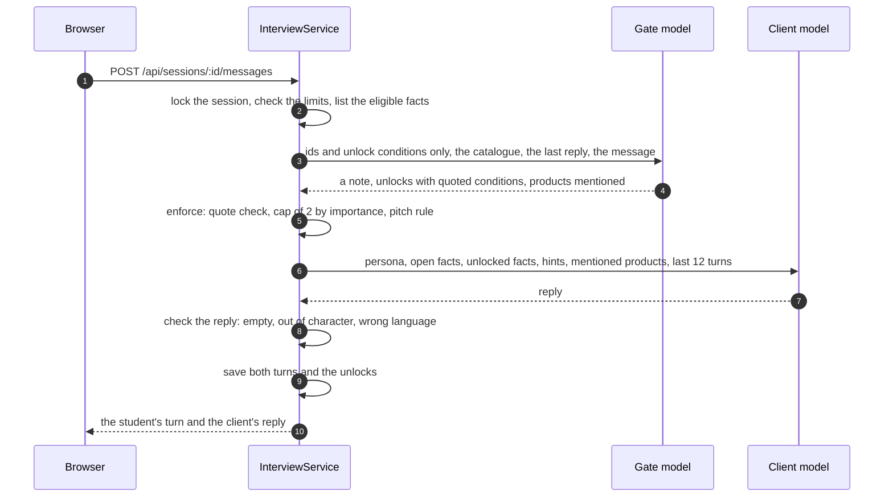
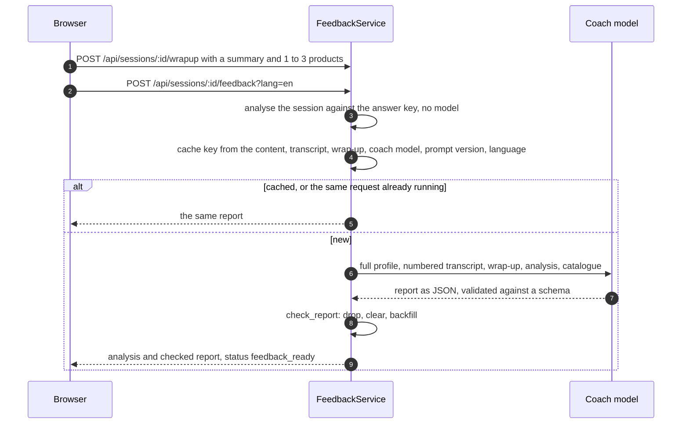

# Architecture

**The shape of the app:**
- **One process.** A single FastAPI process serves the API and the built React app.
- **Models.** Every model call goes to one OpenAI-compatible Chat Completions endpoint: Ollama locally, or Groq.
- **Content.** It comes from YAML files.
- **State.** Interviews live in memory. There is no database and no login.

The [decision records](decisions/README.md) explain why. This page explains how.

## Components

| Package (`backend/app/`) | What it does |
|---|---|
| `api/` | Routes, which return DTOs from `dto.py` only. Typed errors become `{"error": {"code", "message_key", "detail"}}`. The routes also add the security headers, cap request bodies at 32 KB, and allow one message per second per session. |
| `simulation/` | `InterviewService`: creates interviews, runs each student message through the gate and the client, and records the wrap-up. `SessionStore` keeps the sessions. |
| `coaching/` | `FeedbackService`: the deterministic analysis, the coach call, the checks on the coach's report, the cache, and the Markdown export. |
| `content/` | Loads and validates `content/`, and reloads it while the app runs. |
| `prompts/` | Every prompt, as a Markdown file with `string.Template` placeholders. |
| `llm/` | The only package that imports `openai`: roles, retries, JSON output, health checks. `FakeLLM` stands in for it in tests. |
| `telemetry/` | One JSON line per event in `data/events.jsonl`: timings, counts and ids, never message text unless `LOG_TRANSCRIPTS=true`. |

**One code path.** The API, `scripts/chat.py` and the evaluation harness all call the same `InterviewService` and `FeedbackService`. So what the evaluation measures is what students get.

## One interview turn

**1. Eligible facts.** A hidden fact is eligible when it is locked and every fact it `requires` is unlocked. Eligibility is worked out before the turn, so a fact never unlocks in the same turn that makes it eligible.

**2. The gate** (`simulation/disclosure.py`, `prompts/gate.md`).
- **Input**, built in code as one JSON message:
  - each eligible fact's id and `unlock_when` conditions;
  - the other facts' ids, conditions and status, so the gate can tell when a message fits another fact better;
  - the catalogue;
  - the client's previous reply;
  - the student's message.

  A fact's content and its hint are never part of it.
- **Output:** `{note, unlocked, products_mentioned}`, at temperature 0 with at most 200 tokens. The `note` comes first, so the model reasons before it decides.

**3. Enforcement** (`enforce`). The model only suggests. Code then:
- keeps an unlock only if the fact is eligible and the quoted behaviour equals one of that fact's own `unlock_when` lines, ignoring case and surrounding spaces; anything else is rejected and logged;
- caps unlocks at `MAX_UNLOCKS_PER_TURN` (2), keeping critical facts first, then important, then minor;
- applies the **pitch rule**: a mentioned catalogue product unlocks every eligible fact whose `unlock_on_product_pitch` lists it, beyond the cap. That is the client reacting to a pitch, not the student earning a fact.

If the gate call fails, nothing unlocks and the turn goes on.

**4. The client** (`simulation/client_agent.py`, `prompts/client_system.md`).
- **Its system prompt holds:**
  - the bank;
  - the persona;
  - the open facts;
  - the facts unlocked so far;
  - a hint for each eligible fact that has one: the fact's authored `signal`, never its content;
  - the `client_view` line of each product the student has mentioned.
- **History and sampling:** it sees the last `CLIENT_HISTORY_TURNS` (12) turns, at temperature 0.7 with at most 250 tokens.
- **Code then checks the reply:**
  - an empty reply is retried once;
  - a reply that talks about being an AI, a model or a prompt is regenerated once with `client_reminder.md`, then replaced by a fixed in-character line;
  - a reply in the wrong script for the student's message is regenerated once with `client_language.md`.

**5. Saving.** The turn is saved only after the client's reply, so a failed reply leaves the session unchanged. The session's lock allows one operation at a time.

## Feedback

**Analysis** (`coaching/analysis.py`). No model is involved. It covers:
- **Needs:** each need's status: uncovered by questions, revealed only by a pitch, partly uncovered, or missed.
- **Facts:** when each hidden fact came out, and whether a question or a pitch brought it out.
- **Verdicts:** one for each recommended product: suitable, unsuitable (with the answer key's reason and, if the client had already ruled it out, the turn), or not in the answer key.
- **Missed opportunities:** suitable products the student didn't recommend.
- **Counts:** never a score.

**The coach** (`coaching/coach.py`, `prompts/coach.md`).
- **When:** after the wrap-up, and not before.
- **Input:**
  - the whole client profile, locked facts included;
  - the numbered transcript;
  - the wrap-up;
  - the analysis;
  - example questions for the facts the student missed;
  - the catalogue.
- **The call:** it asks for JSON through `response_format`, falling back to the prompt if a server rejects it. Temperature 0.3 and 1,500 tokens.
- **An unusable reply** gets one retry, with twice the tokens if the first reply was cut off.

**The checks** (`check_report`). Code removes what it can show is wrong, and adds what is missing:
- **Dropped:**
  - praise that cites no student turn, or cites the pitch of an unsuitable product, or a turn where a fact was missed;
  - an item that quotes the client's own words as the student's question;
  - a "missed" item about a product the student did recommend, unless that product is unsuitable.
- **Cleared:** a suggested question or example that names a product.
- **Corrected or limited:**
  - evidence turns must be the student's;
  - unknown ids become null;
  - each list keeps at most 4 items.
- **Added:** a missed critical need that the coach left out, written from the content.
- **Counted only:** Arabic fields that contain Latin words.

The page says the coach can make mistakes.

**Degraded mode.** If the coach fails after its retries, the page still shows the analysis, with a notice and a button to ask again. Degraded outcomes are never cached.

**Cache** (`coaching/cache.py`).
- An in-memory LRU of 128 reports.
- It shares a call that is still running, so a double click asks the coach once.
- Each language has its own report, so switching back is instant.

**Export.** `GET /api/sessions/:id/export?format=md` renders the session as Markdown in the language of the latest feedback. [samples/](../samples/) holds one.

## The model layer

`llm/client.py` defines `LLMClient` (`chat`, `chat_json`, `list_models`) and its one implementation, `OpenAICompatClient`, on the async `openai` SDK.

**Roles.** Each of the gate, the client and the coach takes its model from its own setting, or else from `LLM_MODEL`. Each also has its own timeout (30, 90 and 240 s).

**Retries.**
- Timeouts, connection errors, 429 and 5xx are retried `LLM_MAX_RETRIES` times (2): after 0.5 s, then 1 s, plus up to 0.25 s of jitter.
- A server's `Retry-After` is honoured, up to 5 s.
- Other 4xx errors fail at once.

**Concurrency.** `LLM_MAX_CONCURRENCY` (1) calls at a time, which suits one local GPU.

**Portability.**
- The client sends `reasoning_effort="none"` to turn thinking off. If a server rejects that parameter, or `response_format`, the client drops it and asks again.
- Any thinking text is stripped from replies.

**Telemetry.** Every call emits one `llm_call` event: role, model, prompt version, tokens, latency, attempts and outcome. It never holds message text or the key.

**Health.** `GET /api/health` reports:
- whether the endpoint answers;
- whether each role's model is available;
- whether the content is valid.

The web page turns a problem into a banner with a hint, such as "check that Ollama is running".

## Prompts

`backend/app/prompts/` holds every prompt:
- `gate.md`;
- `client_system.md`, `client_reminder.md` and `client_language.md`;
- `coach.md`.

Python only fills in the `$placeholders`. The loader gives each file a version: the first 8 hex characters of its SHA-256. That version goes with every model call, into the coach's cache key, and into the evaluation's results.

## Content

`content/` holds `bank.yaml`, one file per client and one per product.

**Validation.** Pydantic models validate each file strictly:
- unknown fields are errors;
- ids must match file names;
- products and facts must exist;
- `requires` can't be circular;
- each client has a critical fact.

A test also requires Arabic for every text that students see. `make validate-content` prints every error with its file and field. `make content-schema` writes the JSON schemas that editors use for autocomplete.

**Hot reload.** `ContentStore` checks the files' modification times and sizes at most every 2 seconds, and reloads when they change.
- **An invalid edit:** the last good version stays in service, and `/api/health` lists the errors.
- **Invalid content at startup:** the app stops.
- **Running interviews:** an interview keeps the client and catalogue it started with.

The [faculty guide](../content/README.md) covers how to write a client.

## Frontend

**Stack.** React and TypeScript (strict), with Vite and Tailwind CSS v4. It uses logical utilities only, so the same layout works left to right and right to left.

**Routes.** `/` (the clients), `/interview/:sessionId`, `/wrapup/:sessionId` and `/feedback/:sessionId`.

**State.** The server holds the state, and each page loads its session from the id in the URL, so a refresh is safe. Each page has its own hook (`useInterview`, `useWrapUp`, `useFeedback`), and there is no global store.

**API types.** They are generated from the backend's OpenAPI document (`make openapi` writes `src/api/schema.d.ts`), and calls go through `openapi-fetch`. An error's `message_key` selects its translated message.

**Languages.**
- Every string is in `src/locales/en.json` and `ar.json`.
- A test checks that the two files match, and a lint rule forbids hard-coded text in components.
- Changing the language sets `<html lang dir>`.
- Text that a student or a model wrote gets `dir="auto"`.

## State and data

**The states.** A session moves from `interviewing` to `wrapped_up` to `feedback_ready`.

**Private content.** A client's private content leaves the server only at `feedback_ready`: the persona, the hidden facts, the needs and the coach notes.

**Sessions.** `SessionStore` keeps sessions in memory:
- each has a lock;
- one idle for `SESSION_TTL_MINUTES` (120) is removed;
- beyond `MAX_SESSIONS` (200), the least recently used one goes.

Restarting the app ends every interview.

**Stored data.** `data/events.jsonl` is the only file the app writes. [Privacy and security](privacy-and-security.md) covers what it holds and what a real deployment would add.

## Rules the tests enforce

Tests enforce these rules:
- **The `openai` import:** only `app/llm/` imports it (`backend/tests/architecture/`).
- **Private content:** no route returns it before `feedback_ready`. The API tests check every route.
- **Locked facts:** no model input during the interview contains a locked fact's content. The isolation tests check this, and a mutation that added the content made all three fail.
- **UI text:** it comes only from the locale files. The `i18next/no-literal-string` lint rule and the locale parity tests check this.
- **The API contract:** the committed OpenAPI document and error-code list match the backend (`test_openapi_export.py`). The frontend's types are generated from them (`make openapi`).
- **Content schemas:** the committed JSON schemas match the content models.
